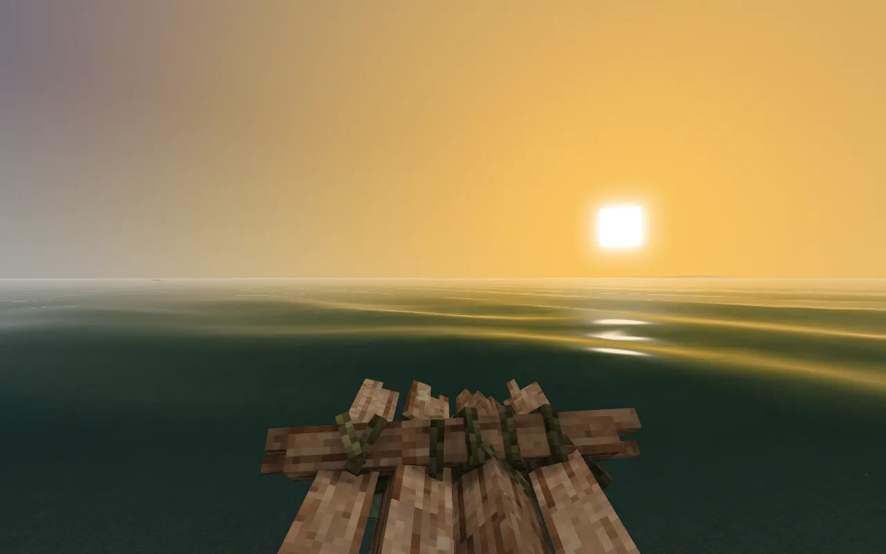

# Sea

Sea gives Vintage Story's oceans real waves. They travel downwind, build up in a storm and calm down slowly after it,
and are the same for every player, so boats and ships can ride them. Vanilla boats follow
the waves, the sailboat sails by the wind, and a boat can take on water in a storm. Sea also redraws the water: sun and
moon glitter, the sky reflected in the sea, foam on breaking crests (and surf on beaches, with coasts on).

This wiki describes **Sea 0.6.2** for Vintage Story 1.22.

## What it needs and what it works with

- **Vintage Story 1.22.0 or later.** Install it on the server and on every client (it is needed on both sides).
- **Nothing else is needed.** Without a weather mod the sea follows a steady breeze from the config.
- It was made primarily for **Earth**: on an Earth world the waves follow Earth's real winds and storms. It also works
  with **Cylinder World** (the waves repeat seamlessly around the ring), **World Map** (the far sea) and the ship mods.
  See [Compatibility](Compatibility).

## Install

Put `sea-0.6.2.zip` into your `Mods` folder (on a server, the server's `Mods` folder; every player needs the same
version). It works in new and existing worlds.

## Quick start

1. Start or open a world and go to the sea.
2. Type `/sea` to see the wind and the waves where you stand, and where the wind comes from.
3. To see a storm sea at once, an admin can type `/sea setwind W 1 0 built` (a storm from the west, fully built, until
   `/sea clearwind`).
4. Take a raft or a sailboat out: they rise and fall with the waves, and the sailboat's sail turns to the wind.

## Pages

- [Waves and wind](Waves-and-wind): where the wind comes from, how the sea builds and calms, storms.
- [Coasts](Coasts) (off by default since 0.6.2): waves turning and breaking on beaches, sheltered water, waves thrown back by cliffs, currents
  and rips.
- [Boats](Boats): rafts and sailboats on the waves, sailing by the wind, water aboard and bailing.
- [The water's look](The-waters-look): sun and moon glitter, sky reflections, foam and spray, night light.
- [Settings](Settings), [Commands](Commands), [Compatibility](Compatibility), [FAQ](FAQ).

## Versions and problems

0.6.2 is the current release. Report problems on Sea's Mod DB page or in this repository's issues, if they are
enabled. `.sea` (client) and `/sea` (server) show what Sea is doing and help with a report.
